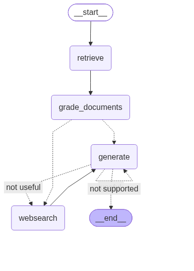

# Agentic RAG with LangGraph

An Agentic Retrieval-Augmented Generation (RAG) project built using **LangGraph and LangChain**. The workflow retrieves relevant documents from a local Chroma vector store, evaluates document relevance, uses Tavily web search as a fallback, and checks generated answers for grounding and relevance.

The project explores how a stateful graph workflow can make a traditional RAG pipeline more adaptive through conditional routing and LLM-based evaluation.

## Overview

Traditional RAG systems generally retrieve documents and generate an answer in a straightforward sequence.

This project introduces additional evaluation steps into that workflow:

- Retrieved documents are evaluated for relevance to the user's question.
- Irrelevant documents trigger a web search using Tavily.
- Generated answers are evaluated for grounding in the available context.
- A separate evaluation checks whether the generated answer addresses the original question.

LangGraph manages the workflow using nodes, shared state, and conditional edges.

## Architecture



### Workflow

The application follows this workflow:

1. **Retrieve:** Retrieves relevant documents from the Chroma vector store using the user's question.
2. **Grade Documents:** Uses an LLM-based retrieval grader to evaluate the relevance of retrieved documents.
3. **Conditional Decision:**
   - If documents are relevant, proceed to answer generation.
   - If any retrieved document is irrelevant, trigger Tavily web search.
4. **Web Search:** Searches the web using Tavily and converts the returned content into a LangChain Document.
5. **Generate:** Generates an answer using the question and available document context.
6. **Hallucination Grading:** Evaluates whether the generated answer is grounded in the provided documents.
7. **Answer Grading:** If the answer is grounded, checks whether it addresses the original question.
8. **Final Output:** Returns the generated answer when both evaluations pass.

The graph uses conditional edges to determine the next step based on the evaluation results.

## Technologies Used

| Technology | Purpose |
|---|---|
| Python | Core programming language |
| LangChain | LLM integration and RAG components |
| LangGraph | Stateful workflow orchestration |
| OpenAI GPT-4o-mini | Answer generation and LLM-based grading |
| OpenAI Embeddings | Document embeddings |
| ChromaDB | Vector storage and retrieval |
| Tavily Search | Web search fallback |
| Unstructured | Loading content from web URLs |
| UV | Python dependency and environment management |

## Project Structure

```text
agentic-rag/
│
├── graph/
│   ├── chains/
│   │   ├── answer_grader.py
│   │   ├── generation.py
│   │   ├── hallucination_grader.py
│   │   └── retrieval_grader.py
│   │
│   ├── nodes/
│   │   ├── retrieve.py
│   │   ├── grade_documents.py
│   │   ├── generate.py
│   │   └── web_search.py
│   │
│   ├── consts.py
│   ├── graph.py
│   └── state.py
│
├── ingestion.py
├── main.py
├── graph.png
├── graph1.png
├── pyproject.toml
├── uv.lock
├── .gitignore
└── .python-version
```

### Key Components

**1. ingestion.py**
- Loads content from selected web articles using UnstructuredLoader.
- Splits documents using RecursiveCharacterTextSplitter.
- Uses a chunk size of 250 tokens and zero overlap.
- Configures OpenAI embeddings.
- Configures a persistent Chroma vector store and retriever.

**2. graph/state.py**
- Defines GraphState using TypedDict.
- Maintains the question, generated answer, web-search flag, and documents throughout the workflow.

**3. graph/nodes/**
- `retrieve.py`: Retrieves documents from the vector store.
- `grade_documents.py`: Evaluates document relevance.
- `web_search.py`: Performs web searches using Tavily.
- `generate.py`: Generates answers using retrieved or web-search context.

**4. graph/chains/**
- `retrieval_grader.py`: Evaluates whether retrieved documents are relevant.
- `generation.py`: Generates answers using the question and retrieved context.
- `hallucination_grader.py`: Evaluates whether the generated answer is grounded in the provided documents.
- `answer_grader.py`: Evaluates whether the answer addresses the user's question.

**5. graph/graph.py**
- Defines the LangGraph StateGraph.
- Connects workflow nodes.
- Implements conditional edges for document grading and answer evaluation.
- Compiles the graph into an executable application.

**6. main.py**
- Entry point for executing the compiled LangGraph application.
- Invokes the graph with a sample question and prints the generated answer.

## Knowledge Base

The ingestion pipeline is configured to load the following articles:

- [LLM Powered Autonomous Agents](https://lilianweng.github.io/posts/2023-06-23-agent/)
- [Prompt Engineering](https://lilianweng.github.io/posts/2023-03-15-prompt-engineering/)
- [Adversarial Attacks on LLMs](https://lilianweng.github.io/posts/2023-10-25-adv-attack-llm/)

These articles are loaded, split into smaller chunks, and used as the source documents for vector retrieval.

## Installation and Setup

### Prerequisites

- Python 3.12 or later
- UV package manager
- OpenAI API key
- Tavily API key

### 1. Clone the repository

```bash
git clone https://github.com/Katla-Adithya/Agentic-Rag.git

cd Agentic-Rag
```

### 2. Install dependencies

```bash
uv sync
```

### 3. Configure environment variables

Create a `.env` file in the project root directory:

```env
OPENAI_API_KEY=your_openai_api_key
TAVILY_API_KEY=your_tavily_api_key
```

Keep your API keys private. Do not commit the `.env` file to GitHub.

### 4. Initialize the Chroma vector store

**Important:** The `Chroma.from_documents()` initialization block in `ingestion.py` is currently commented out.

Before the first execution, uncomment the existing initialization block:

```python
vectorstore = Chroma.from_documents(
    documents=doc_splits,
    collection_name="rag-chroma",
    embedding=OpenAIEmbeddings(),
    persist_directory="./.chroma",
)
```

Then execute:

```bash
uv run python ingestion.py
```

This loads the configured articles, splits them into chunks, generates embeddings, and stores them in ChromaDB.

The project subsequently uses the persistent `rag-chroma` collection for retrieval.

### 5. Run the application

```bash
uv run python main.py
```

The application invokes the compiled LangGraph workflow with the sample question:

```python
{"question": "what is agent memory?"}
```

The generated answer is printed in the terminal.

## Environment Variables

| Variable | Description |
|---|---|
| `OPENAI_API_KEY` | Used for OpenAI chat models and embeddings |
| `TAVILY_API_KEY` | Used for Tavily web search |

## Current Implementation Notes

- The workflow starts with vector-store retrieval rather than a separate question-routing step.
- Document relevance is evaluated using structured LLM output.
- Web search is implemented as a fallback using Tavily.
- Answer grounding and question relevance are evaluated using separate grading chains.
- The current generation retry path does not implement a maximum retry counter.
- The Chroma vector store must be initialized before the application can retrieve documents.

## Future Improvements

- Add a maximum retry limit to prevent indefinite generation loops.
- Implement query rewriting when retrieved documents are insufficient.
- Add source attribution to generated answers.
- Improve ingestion by separating indexing from application startup.
- Add automated tests for graph nodes and workflow execution.
- Add an interface for interacting with the application.

## Learning Objectives

This project is an implementation exercise focused on:

- Understanding Agentic RAG architecture.
- Building stateful workflows using LangGraph.
- Integrating LangChain components with LangGraph.
- Implementing document retrieval and relevance grading.
- Integrating external web search using Tavily.
- Using structured LLM outputs for evaluation.
- Understanding conditional edges and workflow control flow.

## Author

**Adithya Katla**

GitHub: [Katla-Adithya](https://github.com/Katla-Adithya)

Project Repository: [Agentic-Rag](https://github.com/Katla-Adithya/Agentic-Rag)
